To check the indexing status, URL Indexing needs to connect to Google Search Console (GSC) with **your own Google app**. You create the app once in Google Cloud Console. It is free and takes about 10 minutes.

Why your own app? Google only lets an app check a limited number of URLs per day. With your own app, the whole quota is for your site. Your data also stays between your site and Google.

Before you start, make sure:

- Your site is added to [Google Search Console](https://search.google.com/search-console).
- Your Google account is an **owner** or a **full user** of that site in Google Search Console.

There are 5 steps:

1. Create a project
2. Enable the Google Search Console API
3. Set up the consent screen
4. Create the credentials
5. Connect in WordPress

## Step 1: Create a project

Go to [Google Cloud Console](https://console.cloud.google.com/) and log in with your Google account.

Click the project dropdown at the top-left corner, next to the Google Cloud logo. In the popup, click **New Project**:

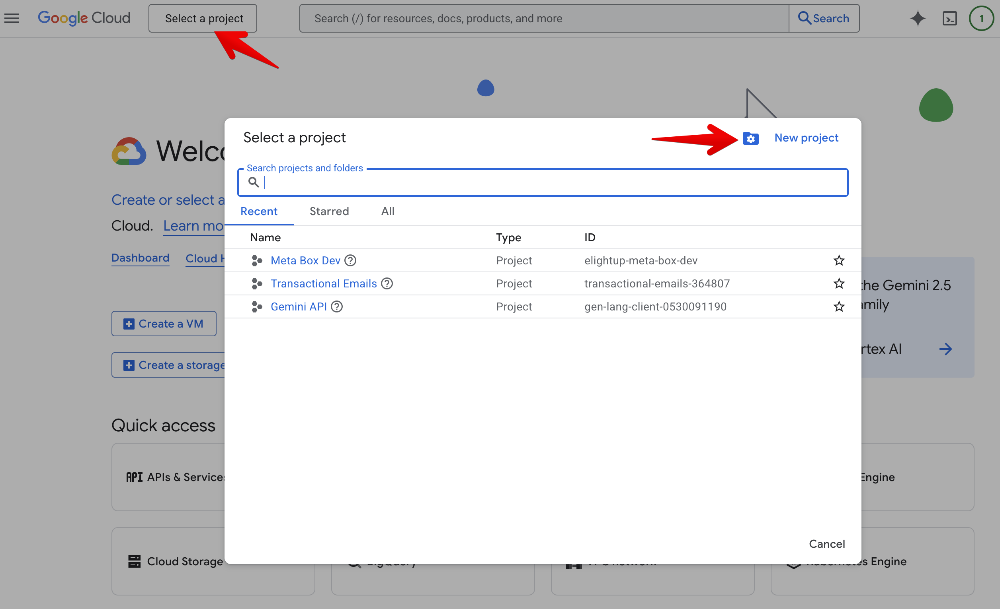

Enter a project name. It can be anything, for example "My site". Then click **Create**:

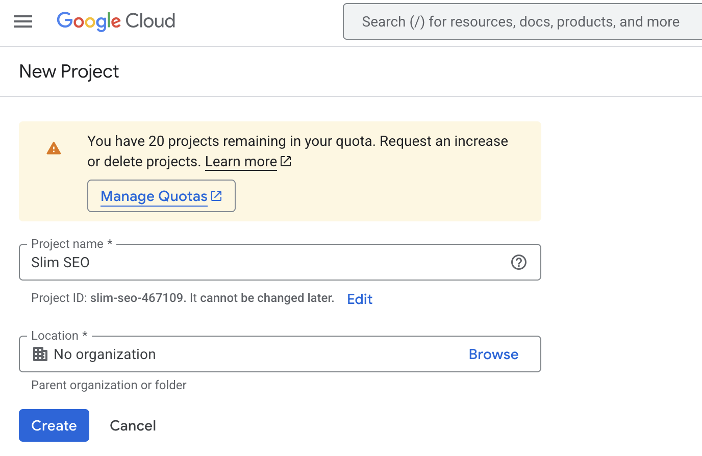

:::tip

If you already have a project, you can use it and skip this step.

:::

## Step 2: Enable the Google Search Console API

Select your project in the project dropdown at the top-left corner.

In the search box at the top, type "Google Search Console API" and click the first result:

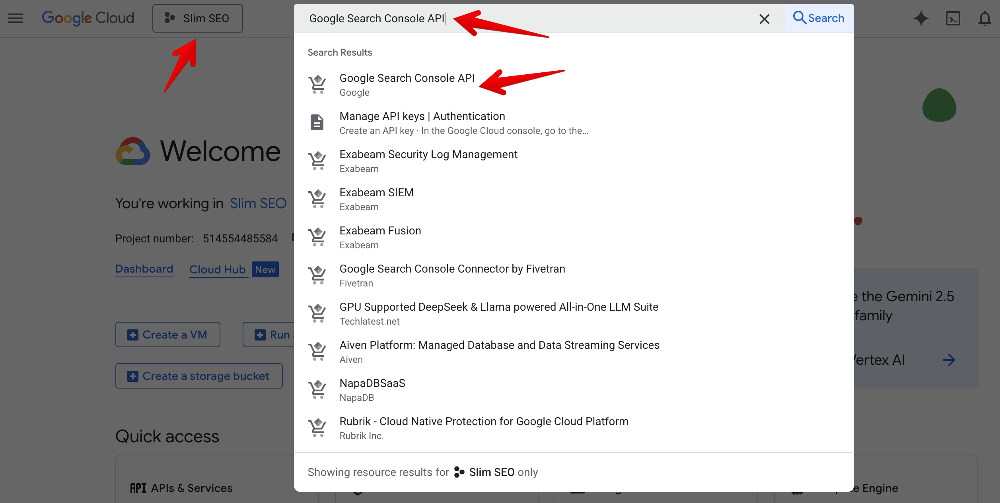

Click **Enable**:

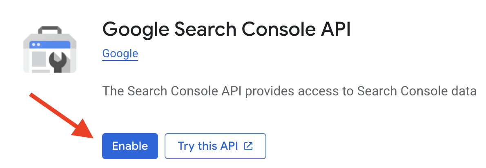

This is the only API you need to enable.

## Step 3: Set up the consent screen

When you connect, Google shows a screen that asks for your permission to read your Search Console data. This is the consent screen. You need to set it up once.

### Branding

From the left menu, select [**OAuth consent screen**](https://console.cloud.google.com/auth/overview):

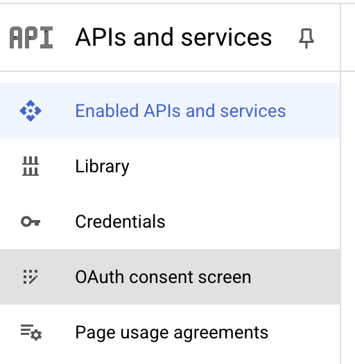

Then select [**Branding**](https://console.cloud.google.com/auth/branding) and click **Get started**:

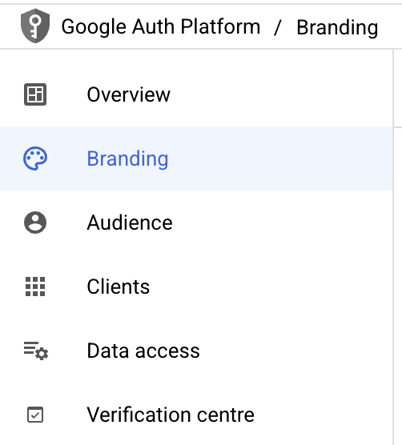

Fill in the form:

- **App name**: any name, for example "My site".
- **User support email**: your email.

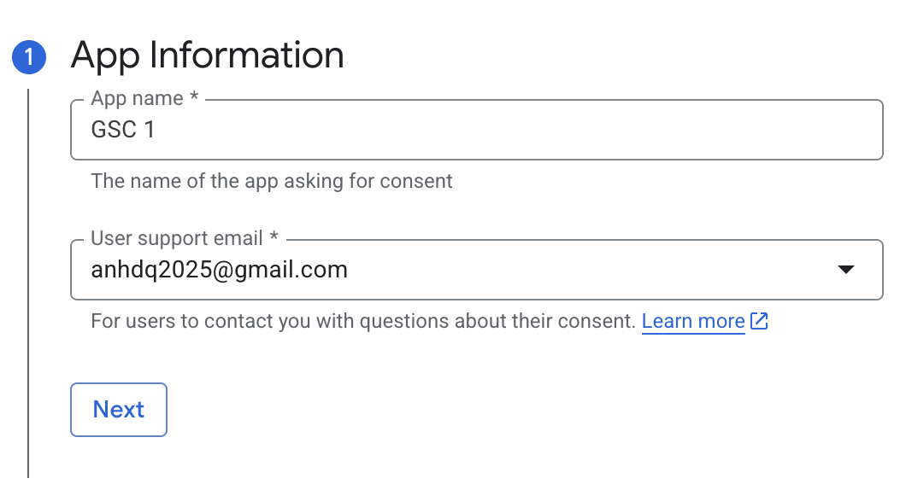

- **Audience**: select **External**.

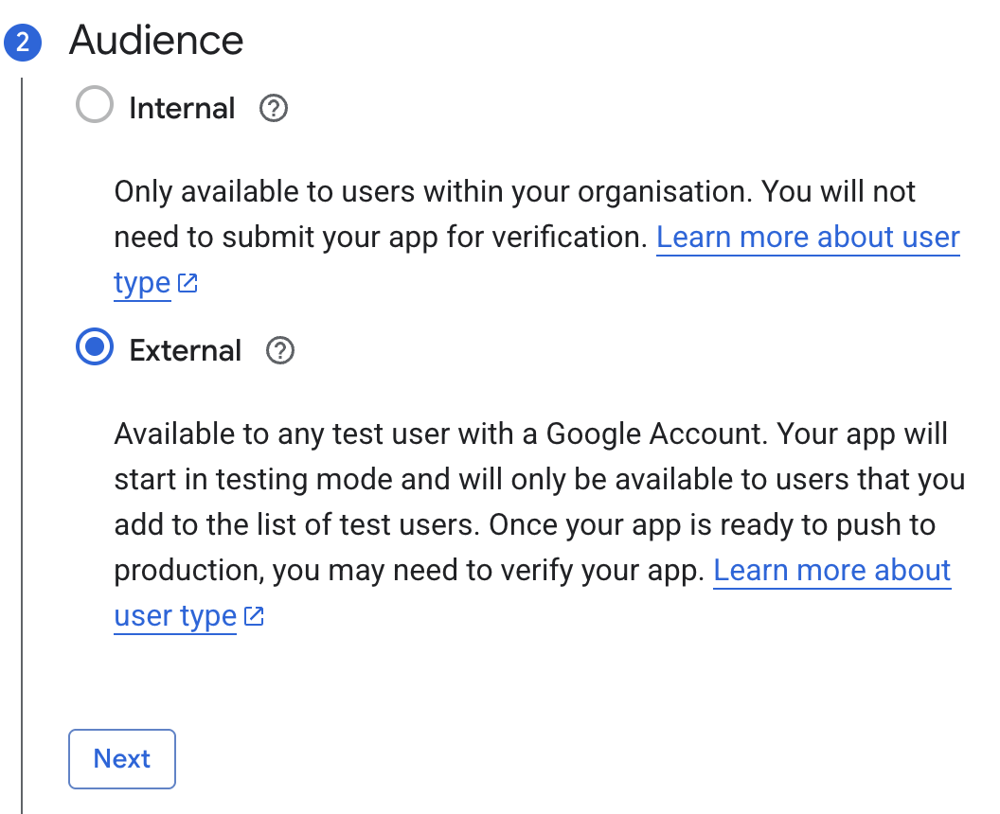

- **Contact information**: your email.

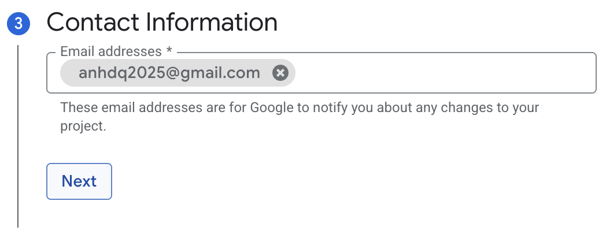

- Agree to the Google API Services policy.

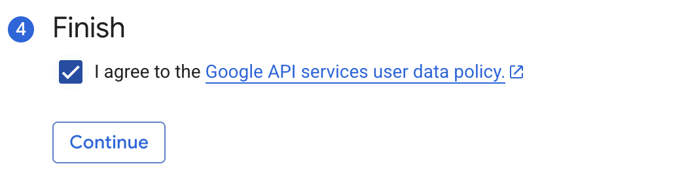

Then click **Create**:

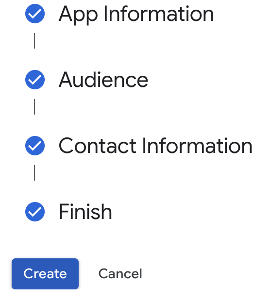

### Publish the app

Go to [**Audience**](https://console.cloud.google.com/auth/audience) and click **Publish app**, then **Confirm**:


## Step 4: Create the credentials

Go to [**Credentials**](https://console.cloud.google.com/apis/credentials). Click **+ Create credentials** at the top and select **OAuth client ID**:

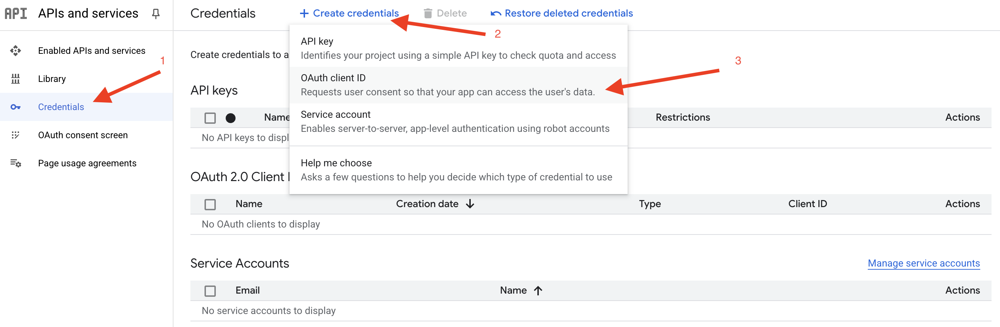

Fill in the form:

- **Application type**: select **Web application**.
- **Name**: any name.
- **Authorized redirect URIs**: click **+ Add URI** and enter:

```
https://yourdomain.com/?ssp_url_indexing_callback=1
```

Replace `yourdomain.com` with your domain. If your WordPress is in a subfolder, add the subfolder too, for example `https://yourdomain.com/blog/?ssp_url_indexing_callback=1`.

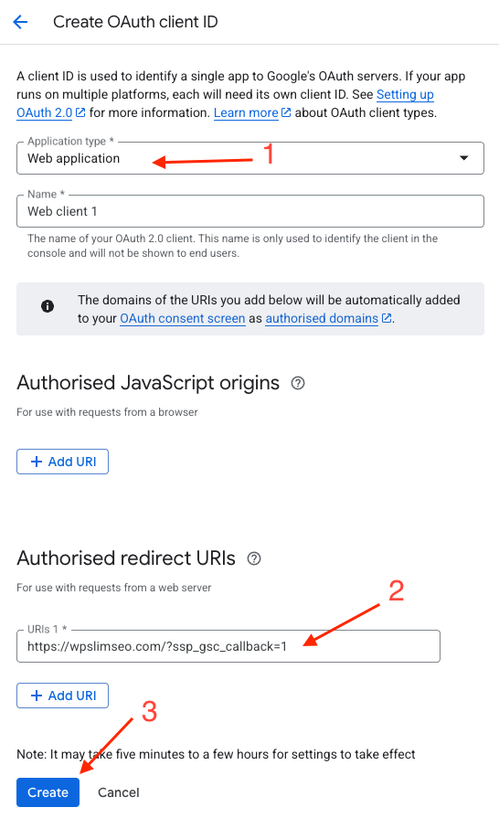

:::info

The URI must match your site **exactly**, including `https` and `www` (if your site uses `www`). If it does not match, Google shows the error `redirect_uri_mismatch`.

:::

Click **Create**. You will see a popup with your **Client ID** and **Client Secret**. Copy them:

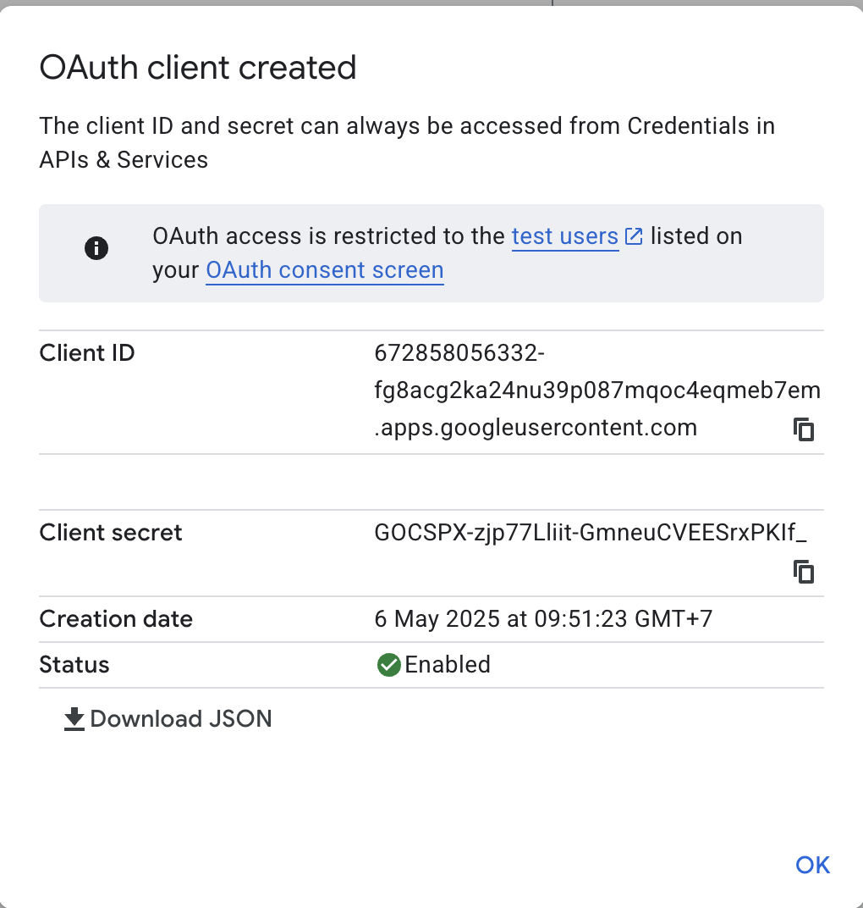

:::tip Multiple sites

You can use the same app for all your sites. Just add one more redirect URI for each site in this step, and use the same Client ID and Client Secret.

:::

## Step 5: Connect in WordPress

Go to **Settings > Slim SEO > URL Indexing tab > Settings**. Paste the **Client ID** and **Client Secret**, then click **Save Changes**.

Go to the **Dashboard** tab and click **Connect to Google Search Console**.

Google asks you to choose your account and allow the app to view your Search Console data. Choose the account that has access to your site in Google Search Console, and click **Continue**.

:::info

Google may show a warning "Google hasn't verified this app". This is normal because it is your own app. Click **Advanced**, then **Go to (your app name)**.

:::

After that, Google sends you back to WordPress. You will see a message that the connection is successful. The plugin starts checking your URLs in the background.

Learn how to [view the indexing status](/slim-seo-pro/url-indexing/indexing-status/).

## Troubleshooting

Problem|Solution
---|---
`redirect_uri_mismatch` error|The redirect URI in step 4 does not match your site. Check `https`, `www`, and the subfolder.
"Current site domain is not matched with any domain in your account"|Your Google account does not have this site in Google Search Console. Add the site to Google Search Console, or connect with another account.
Your site is disconnected after 7 days|The app is still in **Testing** mode. Publish it (step 3), then connect again.
Many URLs show **N/A**|Google's daily quota has run out. Reduce **URLs per run** or increase **Cron interval** in the settings.
