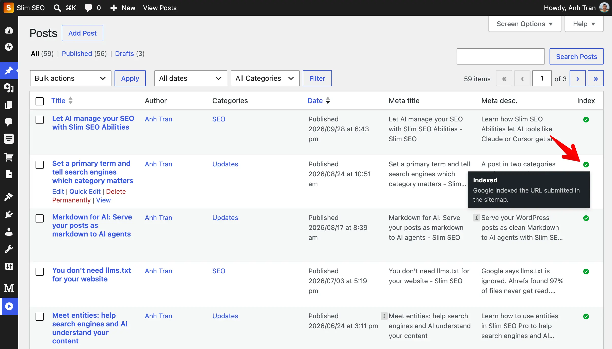

## See the status

Go to the list of posts, pages, or terms. For example, go to **Posts > All Posts**. The status icon appears in the **Index** column.

Hover over the icon to see the status and Google's explanation.

If you use Slim SEO Free, the status appears in the **Index** column of Slim SEO Free.

If you set a post to *noindex* in Slim SEO, a small red dot appears next to the icon. The tooltip also says the post is set to noindex.

## Statuses

Status|Meaning
---|---
Not Queued|The URL is not in the queue yet.
Queued|The URL is waiting to be checked.
Checking|The plugin is checking the URL now.
Indexed|Google has indexed the URL.
Not Indexed|Google knows the URL but did not index it. For example, Google read the page but chose not to index it, or the URL redirects to another page.
No Index|Google does not index the URL because of a *noindex* tag or the *robots.txt* file.
Attention|The URL has a problem you should check. For example, Google has not found the URL, the page shows a 404 error, or Google chose a different main URL.
N/A|The plugin could not get the status from Google. For example, the daily limit ran out. The plugin tries again on the next run.

## When the plugin checks again

The plugin does not check every URL every day. It waits based on the last status:

Status|Checks again after
---|---
Indexed|30 days. You can change this in the [settings](/slim-seo-pro/url-indexing/settings/).
No Index|7 days. You can change this in the [settings](/slim-seo-pro/url-indexing/settings/).
Not Indexed, Attention|1 day
N/A|The next run

The plugin also checks a URL again when:

- You publish a new post or term.
- You change the URL (slug) of a post or term.
- You change the permalink structure in **Settings > Permalinks**. When you save this page, a message says the change affects Google indexing.

The plugin also scans all URLs every 3 days to find URLs that have changed.
